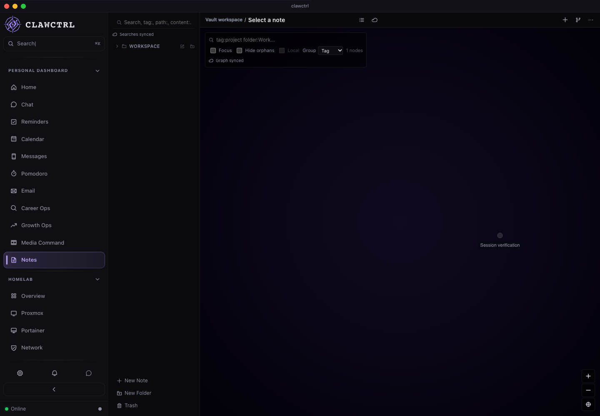
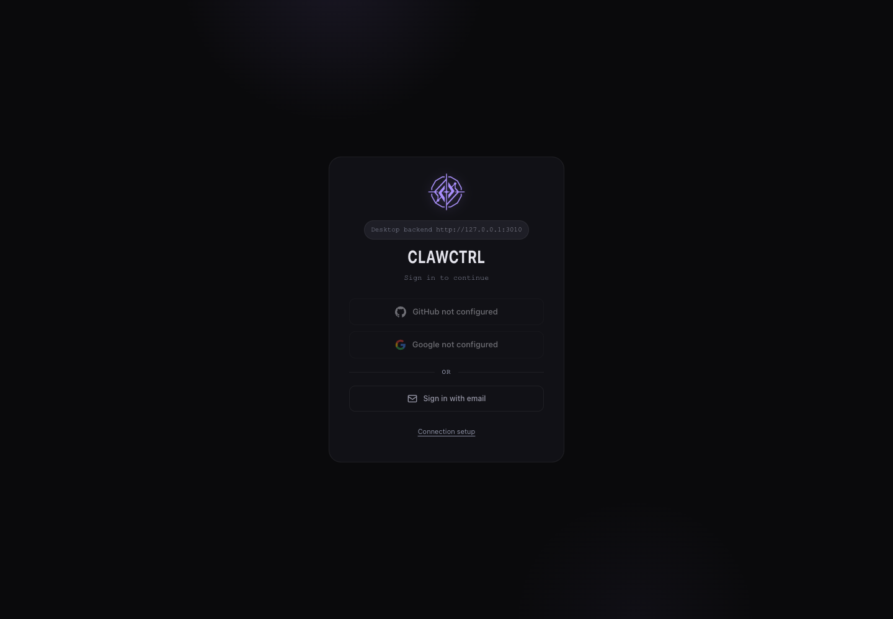

# R01 session-security review

Implementation: `c18909b`; [draft PR 64](https://github.com/Josue7211/clawctrl/pull/64), stacked on PR 63.

## Behavior

Development snapshots contain AES-256-GCM ciphertext and a nonce. The backend-only wrapping key stays in the OS credential store, with no environment or plaintext fallback. Startup checks the snapshot lifetime and verifies the provider subject before starting background work. Logout deletes persistence before reporting success; late persistence, refresh, and account-key updates cannot restore the logged-out session.

Upgrading discards the legacy plaintext session and checkpoints the live database WAL. Sign in once after upgrading. This cleanup does not erase historical backups. If protected storage is unavailable, login remains usable for the running process and another login is required after restart. Release builds still start signed out.

## Verification

- `npm run test:sessions`: 11 deterministic regressions passed (6 persistence, 5 authentication lifecycle). Disposable SQLite and loopback provider only. Unavailable credential storage is injected, including the behavior needed on headless Linux; no actual Linux desktop credential-store roundtrip is claimed.
- `cargo test --manifest-path src-tauri/Cargo.toml --lib session_persistence::tests::os_credential_store_roundtrip -- --ignored --exact`: passed on macOS with a random disposable OS credential entry, deleted after the test.
- The opt-in `server::session_lifecycle_tests::browser_review_fixture` passed while agent-browser/Playwright drove the actual auth routes through the renderer. Other APIs used isolated sample data. Logout, reload, and revisiting Notes returned to login; zero console/page errors. [Structured browser results](r01-results.json).
- Persistence restart is a real disposable SQLite close/reopen test. Browser reload verifies renderer authentication behavior. This evidence does not claim a signed native application cold restart or a real-user provider login.
- Full local `npm run check:all` passed: 11 backend session tests, all 4,145 frontend tests across 255 files, architecture/type/dead-code checks, production build, bundle budget, and Rust compilation. Changed Rust files passed `rustfmt --check`; `git diff --check` passed. [Current macOS/Linux CI](https://github.com/Josue7211/clawctrl/pull/64/checks) was still running at handoff. R02 still owns execution of the full deterministic backend suite and CI build caching.

## Authenticated renderer

## After logout and reload

