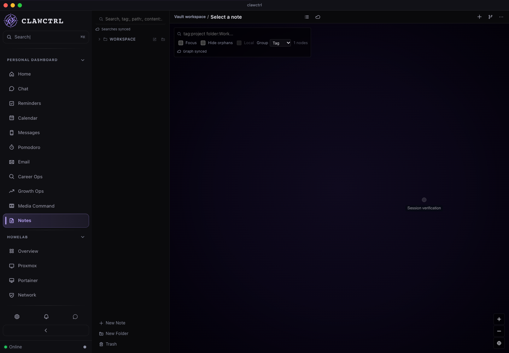
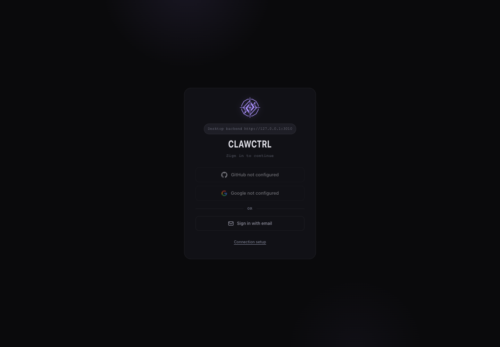

# R02 backend CI review

Implementation revision: `47f2e4a`; [draft PR 65](https://github.com/Josue7211/clawctrl/pull/65), stacked on PR 64. [Test inventory and commands](../backend-testing.md).

## Acceptance

The default desktop gate executes the complete ordinary Rust test suite on both supported desktop CI platforms, and a failing backend regression stops the gate. Credential-store and externally driven browser checks remain explicit opt-ins.

## Verification

- Before the test repairs, the new `npm run test:backend` command reported 709 passing / 13 failing / two ignored cases and returned exit code **101**. `check:all` invokes this command in an `&&` chain without masking failures; CI invokes that same root gate.
- After repairs, the macOS backend run passed **722** tests, with **two** opt-ins ignored. Cargo also executed both binary test targets (currently zero tests each). The count includes the 11 R01 session regressions.
- The first failures were macOS temporary-path canonicalization assumptions and a count assertion that did not account for duplicate keyring aliases. One path assertion poisoned the environment lock, producing eight follow-on failures. Expectations now use canonical paths and unique environment names.
- The terminal environment sanitizer keeps the same allowlist and forced TERM. An injected lookup gives its test disposable values without changing the process HOME or reading personal credentials.
- The full Cargo formatting check passed after correcting one existing assertion's layout. The Clippy correctness/suspicious gate passed; existing style/performance suggestions remain warnings.
- The live browser smoke passed on this source: authenticated fixture Notes rendered, logout succeeded through the real Rust auth route, reload and revisiting Notes returned to login, and console/page errors were **zero**. [Structured results](r02-results.json). Other services used disposable fixtures.
- The full local `npm run check:all` passed on `47f2e4a`: 722 backend tests, 4,145 frontend tests, Rust formatting, selected Clippy gates, architecture/type/dead-code checks, production build, bundle budget, and Rust compilation. The same full gate passed on both macOS and Linux in [run 41249725389](https://github.com/Josue7211/clawctrl/actions/runs/41249725389) at `47f2e4a`: each reported 722 backend and 4,145 frontend tests. Both platform jobs saved their Rust cache archives (about 782 MiB macOS and 1,152 MiB Linux). Cache saves are verified; warm-run timings remain unmeasured.

## Live renderer smoke

## Limits and next work

This package enables existing tests; it does not establish complete feature coverage. The ordinary suite does not prove native installation, a real provider login, or a Linux desktop credential-store roundtrip. Browser smoke is renderer coverage, separate from the backend unit and loopback integration tests. Native credential-store verification remains the R01 opt-in.

The Cargo cache restores dependency downloads and build outputs; hits never skip checks. Compiler/dependency changes can miss the cache. No application data migration is introduced by R02. R03 owns a committed, repeatable feature review runner and interaction recordings; this manual smoke does not mark R03 complete.
