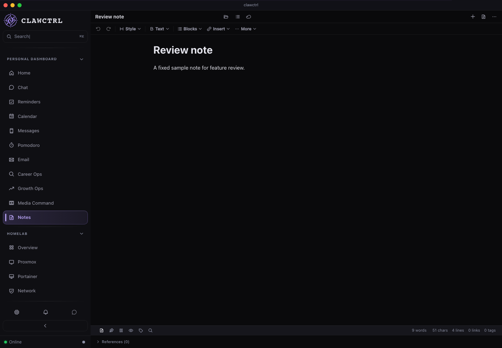
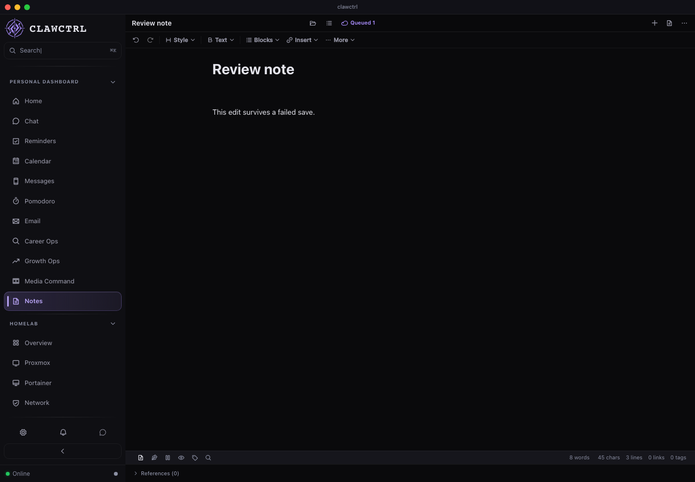
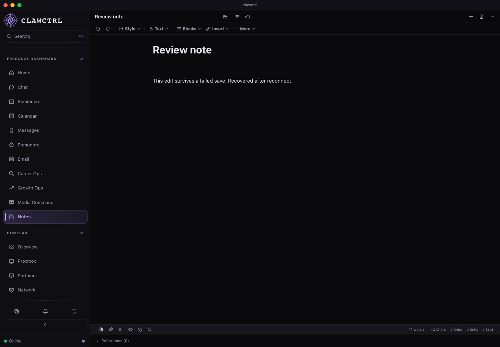
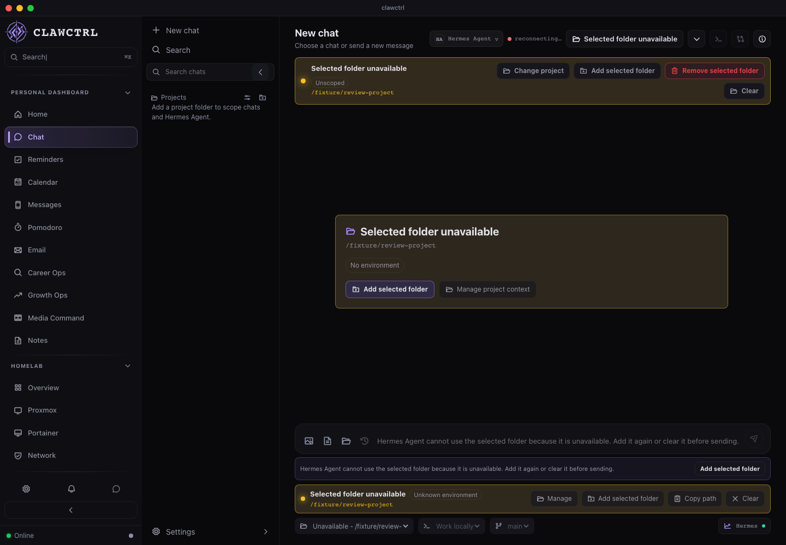
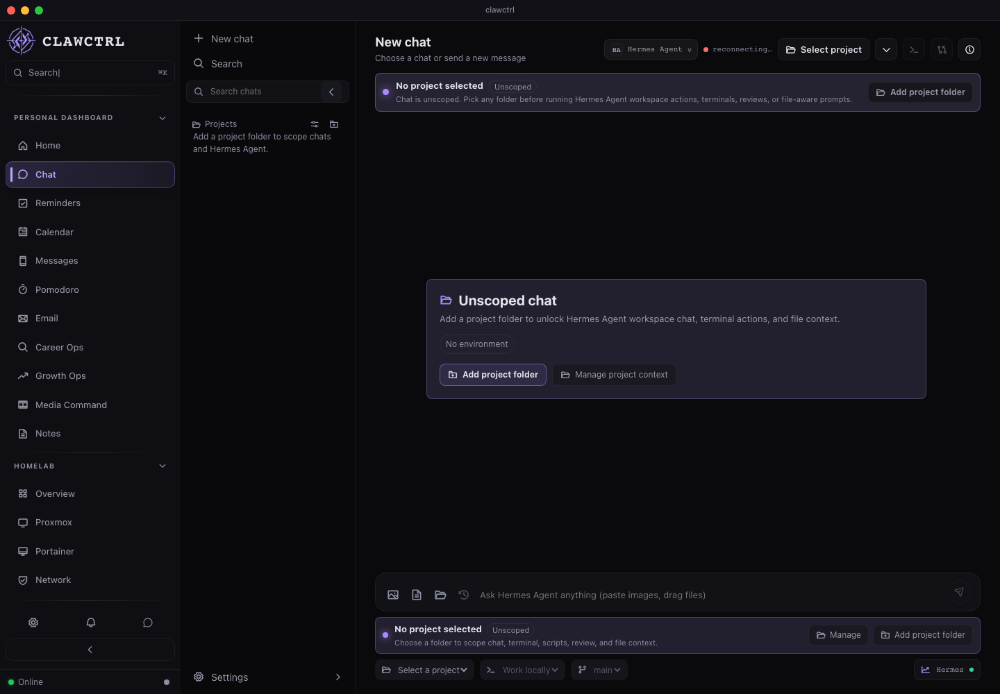
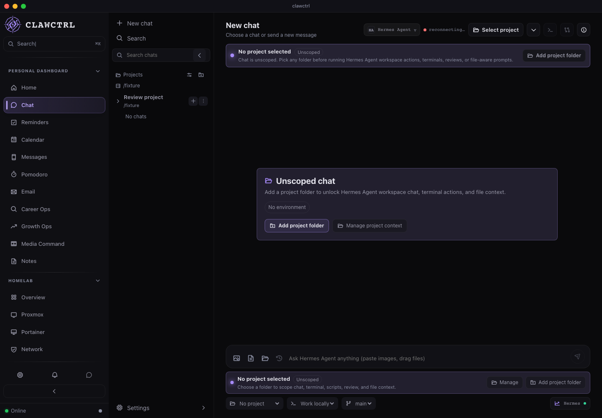

# R03 reference review

Generated with `npm run review:features` using the real React frontend and disposable browser fixtures. Implementation revision: `342854e`, [draft PR 66](https://github.com/Josue7211/clawctrl/pull/66). [Runner and coverage guide](../feature-review.md). Source revision and CI evidence are recorded in the [implementation ledger](../implementation-map.md#verification-and-completion-ledger).

All three scenarios passed in a single `--repeat-each=2` run (six passes); the final Notes record and Chat selection evidence matched between repeats. Notes/Chat recorded zero unexpected browser errors and zero unmodeled requests. The intentional Notes HTTP 503 diagnostic is reported separately. The network guard case verified exactly three deliberate blocks. The complete local desktop gate passed (722 backend / 4,145 frontend tests, formatting/lint, build, budgets, and compilation). The HTML report and its video playback were inspected through agent-browser at a 390px viewport. [Structured reference results](r03-results.json).

The [Linux browser CI job](https://github.com/Josue7211/clawctrl/actions/runs/41341591283/job/124952756290) passed all three scenarios on this implementation. Its [downloadable artifact](https://github.com/Josue7211/clawctrl/actions/runs/41341591283/artifacts/13097333461) was downloaded and checked for the report, screenshots, videos, zero unexpected errors, and the recorded Chat selection order. The full macOS/Linux desktop jobs were still running when this evidence was recorded; the local full desktop gate passed.

## Notes: failure and recovery

[Short Notes interaction recording (WebM)](r03-notes.webm).

## Chat: late workspace response

[Short Chat interaction recording (WebM)](r03-chat.webm).

This is desktop renderer evidence. Native service/IPC behavior and iOS delivery require their own checks. These reference images use fallback fonts so the review never fetches external font services.
