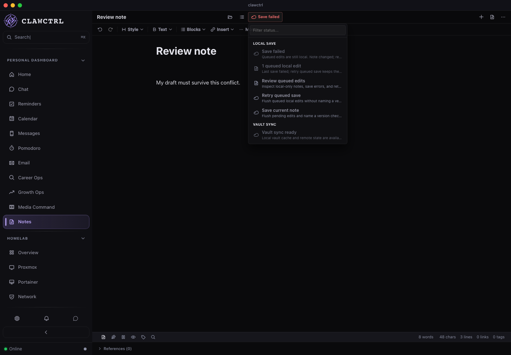
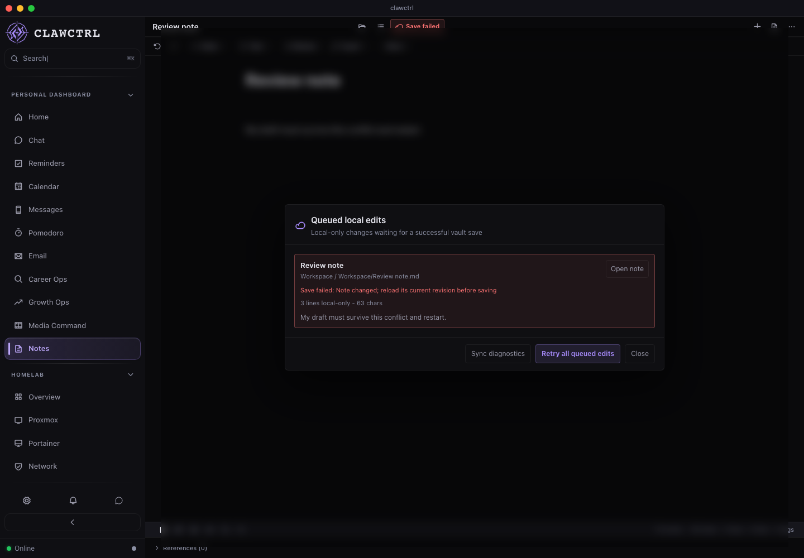

# R04 Notes contract review

Implementation: `caf5a55`, [draft PR 67](https://github.com/Josue7211/clawctrl/pull/67),
stacked on R03. [Contract, ownership, and retry/migration rules](../../shared/contracts/README.md).
[Structured browser results](r04-results.json).

The same OpenAPI schema validates Rust requests, real HTTP responses, generated
frontend types, and the isolated review fixtures. There is one SQLite note owner.
A future phone client can use this contract; remote auth and a native iOS app are
still separate work.

## Conflict and restart

The real React app loaded revision `local-1768478400000`. The fixture backend then
received another client's edit at `local-1768478400001`. The desktop's stale save
received HTTP 409, retained its text, and showed Save failed. After reloading and
editing again, it still sent its original revision; the backend's newer edit
remained unchanged. The queued-edit dialog displays the error and retained text.
Browser pointer interactions also exposed an existing duplicate outside-menu
listener, which removed portalled menu items before their click. The menu now owns
its own pointer dismissal; the queued-edit action opens in the real browser.

[Conflict/restart interaction recording (WebM)](r04-notes-conflict.webm).

All four isolated scenarios passed locally: save failure/recovery, conflict/restart,
Chat's late workspace response, and the network guard. Screenshots were visually
inspected. Each feature scenario had zero unexpected browser errors or unmodeled
requests. The guard matched its three intentional blocks. Injected 503/409 resource
diagnostics and the exact conflict autosave error are recorded separately; editor
warnings remain visible. This is renderer evidence with disposable fixtures.

## Backend and contract evidence

Six new real HTTP tests use full migrations, a temporary SQLite file, multiple
connections, and loopback sockets. They cover:

- Create/list/read consistency, Unicode and encoded IDs, query/path aliases, and 404.
- Invalid bodies/IDs and writes against a missing revision target.
- Two concurrent writers from one base: one success and one 409; no-revision/stale
  writes also fail without changing the winning note.
- Concurrent identical operation retries, mismatched body/ID reuse, and receipt
  replay after both the HTTP server and SQLite pool restart, later edits, and delete.
- A forced receipt-insert failure after earlier side effects: note, folders, FTS,
  version, audit, and receipt all roll back.
- Existing route authentication and MFA plain-text rejections without mutation.

Removing `_rev` from a real response fails the Rust validator. The two Node
contract tests also reject missing revisions/envelopes and incompatible requests
and errors. A deliberate generated-file change made `--check` exit 1; the file was
restored and the check passed. Two desktop regressions cover 409 draft retention
and retaining the original revision when a newer backend note arrives on reload.
Legacy-import fixtures now require a canonical read after import.

Full local `npm run check:all` passed on the final implementation: 728 backend /
4,147 frontend tests, formatting, selected Clippy gates, architecture/types/dead-code
checks, production build, bundle budget, and desktop compilation. This includes
the pointer-dismissal correction. The [Linux browser CI job](https://github.com/Josue7211/clawctrl/actions/runs/41346561908/job/124967889969)
passed all four scenarios at `caf5a55`. Its [artifact](https://github.com/Josue7211/clawctrl/actions/runs/41346561908/artifacts/13099711423)
was downloaded and checked for four result records, zero unexpected errors,
matching expected blocks, screenshots/recordings, and preservation of the original
revision and newer backend content after restart. Native macOS/Linux CI is still
running; its status is recorded in the implementation ledger. Existing style lint warnings remain
visible; the two existing opt-in backend tests remain outside the ordinary gate.

## Limits and recovery

Route tests inject a disposable authenticated session; they do not prove the full
remote authentication middleware, device pairing, revocation, or mobile access.
Personal Obsidian discovery is disabled in test builds. No personal service or
vault was accessed. General Capture inbox, attachments, and other vault mutations
are outside this first CRUD contract. Desktop drafts are browser-local; a durable
mobile outbox remains I03. There is no automatic conflict merge.

Migration 0029 adds receipt storage without rewriting notes. Receipt retention,
compatible code rollback, older-client revision refresh, export/import limits,
and the generator's moderate development-only audit advisories are documented in
the contract guide. Signed app installation, native cold-restart delivery, and an
iPhone installation require their own evidence.
