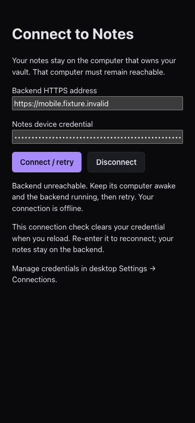
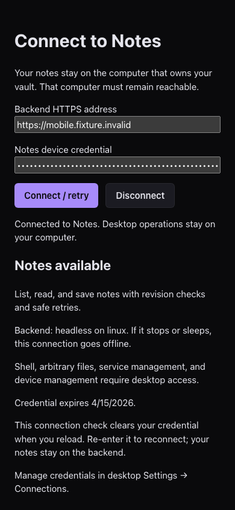
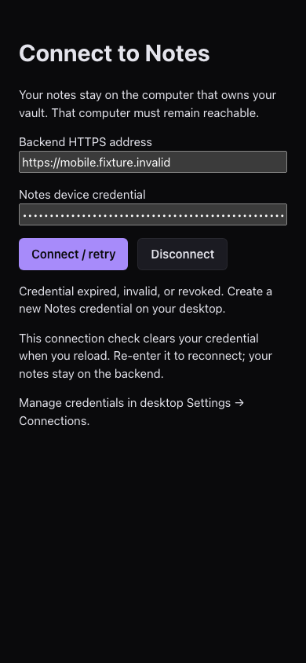
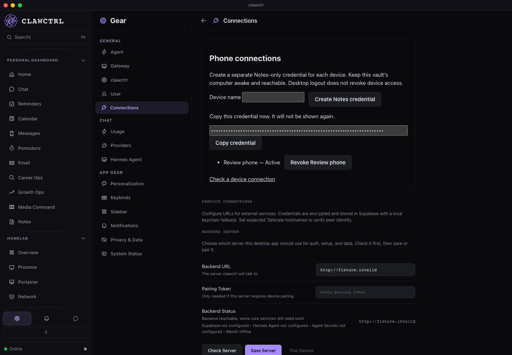
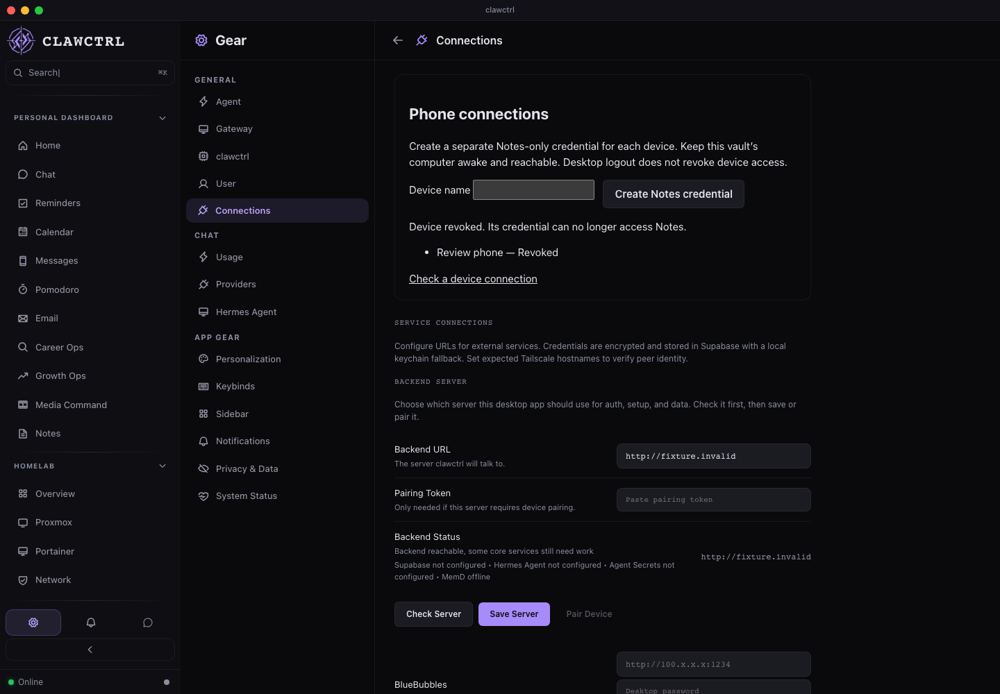

# R05 device connection review

Implementation: `ea31cde`, [draft PR 68](https://github.com/Josue7211/clawctrl/pull/68),
stacked on R04. [Protocol, host decision, and migration limits](../mobile-connectivity.md).
[Structured browser results](r05-results.json).

The Notes-only connection layer is implemented and tested. **R05 still awaits the
selected real host/HTTPS origin and live-path verification.** The provisional host
is the existing vault-owning Mac; it must stay awake and run its backend. No host,
TLS ingress, personal vault, or credential store was reconfigured. I01 can build
the independent native foundation while this deployment input is pending.

## Phone-width connection check

The real React connection view ran at 390 × 844 with disposable backend fixtures.
It showed an honest offline state, recovered to the supported Notes capabilities,
then rejected a revoked credential. The field is cleared on disconnect; checks
confirmed that no device token entered localStorage or sessionStorage. The layout
scrolls within its viewport and its footer remains reachable. This is renderer
verification, not an installed iPhone app.

[Connection-state recording (WebM)](r05-connection.webm).

## Desktop device management

In the real Settings → Connections screen, a disposable device credential was
created and displayed once in a password field. Revoking it updated the device
status and removed the displayed credential. Existing service connections were
modeled as unconfigured, so they did not block the new workflow. No real secret
or service was contacted. Screenshots were visually inspected.

[Create/revoke recording (WebM)](r05-devices.webm).

All six browser scenarios passed: these two plus Notes save failure/recovery,
Notes conflict/restart, Chat late workspace response, and network isolation.
There were zero unexpected browser errors. Feature scenarios had no unmodeled
requests; the guard matched its three deliberate blocks. Exact injected
503/409/401 resource diagnostics, the injected connection refusal, and the known
conflict autosave error were recorded separately. Existing warnings remain visible.
The fixture API exchanges, including device management and capabilities, validate
against the shared contract.

## Verification

Final local `npm run check:all` passed: **732 backend tests and 4,158 frontend tests**,
Rust formatting, selected Clippy gates, architecture/types/dead-code checks,
production build, bundle budget, and desktop compilation. The two Node contract
checks passed. The final focused transport/connection run passed 50 tests.

Four new real HTTP tests exercise the exact production authentication stack with
full migrations and disposable SQLite. They prove:

- A device lists, creates, reads, and updates the same Notes through Rust HTTP
  without Vite or a live owner session; capabilities correctly say headless.
- Stored credentials are hashes; list responses expose neither token nor hash.
- Device credentials cannot use desktop/auth/setup/resource/import/delete/alias
  routes, even alongside a valid desktop key and owner session. Unrelated bearer
  integrations retain their existing desktop key path.
- Owner/MFA checks protect issuance; names validate and another owner cannot revoke
  a device. Different devices revoke independently and expired credentials fail.
- Revocation blocks further requests and receipt replay. A stale principal also
  fails the check inside the write transaction. Device errors are non-cacheable
  and carry the Bearer authentication challenge.

Frontend regressions cover HTTPS-origin validation, redirects, token
non-persistence, offline/rejected/incompatible results, native OS distinction,
stale desktop keys on native mobile, no unconfigured loopback fetch, no desktop
key refresh from mobile requests, cleanup of old connections, and preventing a
pending desktop save from retrying onto a newly selected device connection.
Device management remains on the desktop vault owner when another backend is
configured. The route audit includes the public connection diagnostic.

The [Linux browser CI job](https://github.com/Josue7211/clawctrl/actions/runs/41353090929/job/124987662541)
passed all six scenarios at `ea31cde`. Its [artifact](https://github.com/Josue7211/clawctrl/actions/runs/41353090929/artifacts/13102236886)
was downloaded and verified: six result records, zero unexpected errors, expected
blocks, offline/rejected phone states, owner revocation, screenshots and recordings.
Native macOS/Linux CI remains pending; use the [current PR checks](https://github.com/Josue7211/clawctrl/pull/68/checks)
before merging. The local full gate includes desktop compilation, not a signed
native installation or a native IPC/device launch claim. Ordinary backend tests
retain the same two opt-ins outside the gate. Inherited lint/build warnings remain
visible and dead-code ceilings were not raised.

## Remaining proof

Choose the existing vault owner and its HTTPS origin, forwarding only the Notes
mobile surface. Verify a disposable note through the intended connection path,
revoke that device and receive 401, then stop/sleep and reconnect the host while
preserving the selected vault. Personal deployment, actual TLS ingress, real
phone installation, protected mobile storage, outbox recovery, and TestFlight
remain unverified. Native iOS foundation work is next; its fixture screen does
not depend on choosing the live host.

Migration 0030 adds device metadata and credential hashes without rewriting notes.
Keep its ledger and revocation history on code rollback. An older database restore
can restore pre-revocation state, so revoke/reissue device access after restore.
The protocol guide records this and the existing receipt/export recovery limits.
Desktop logout does not revoke independently issued device credentials; the UI
states that explicitly.
